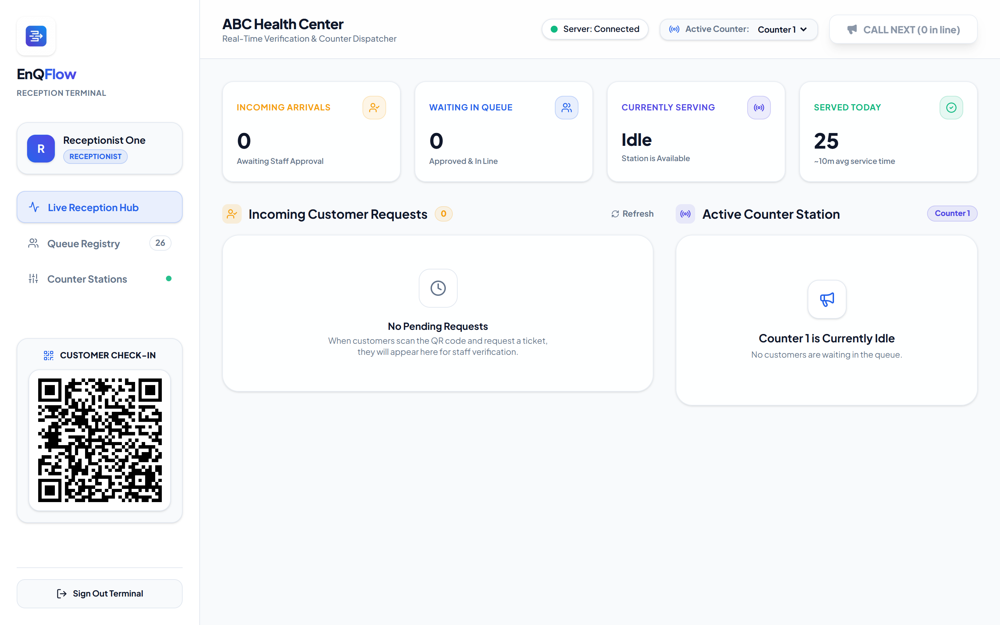
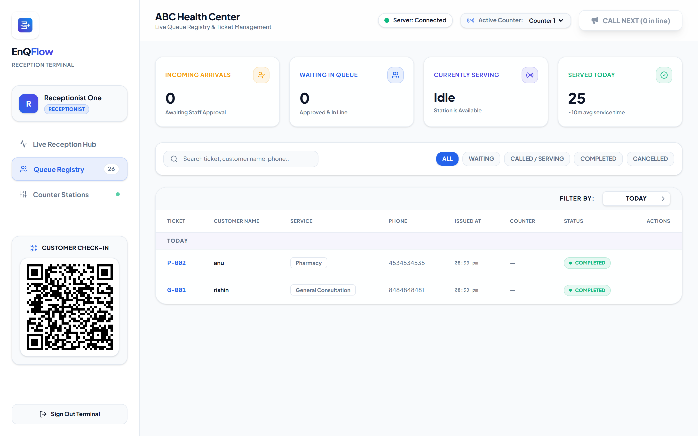
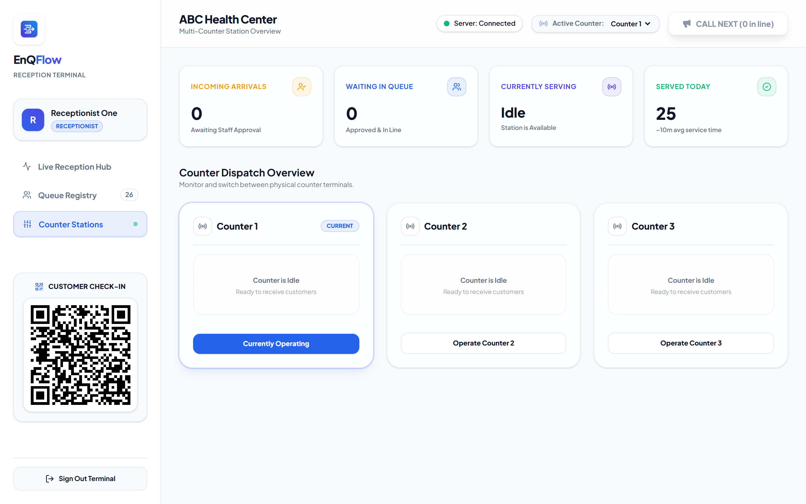
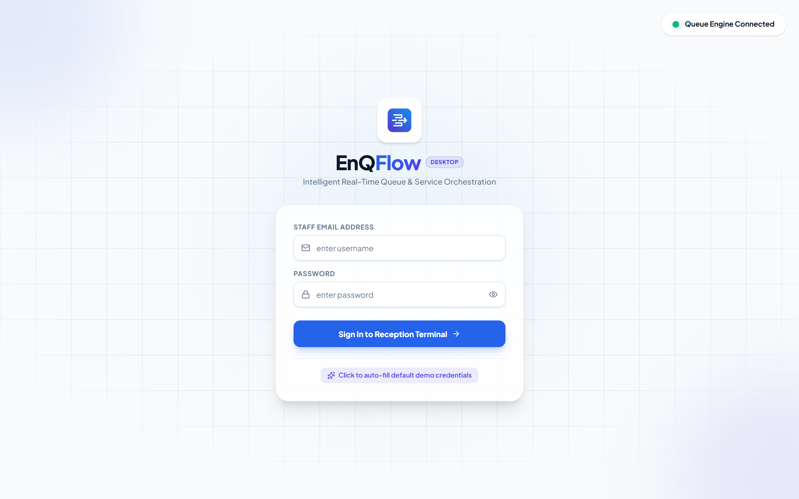
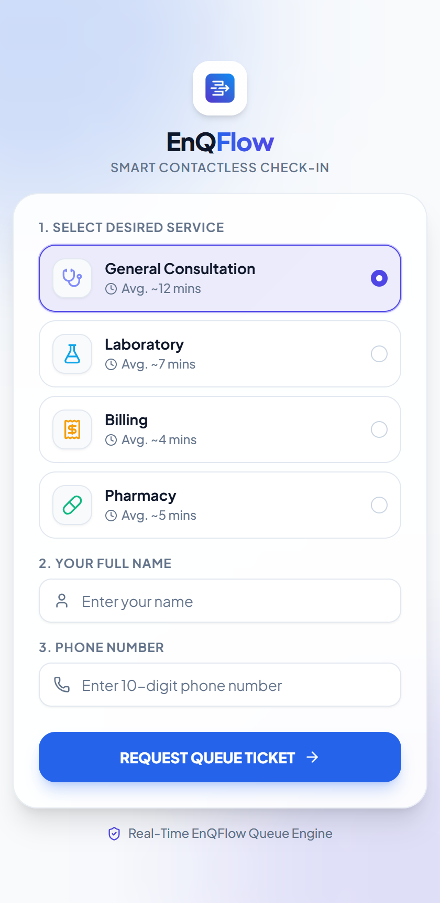
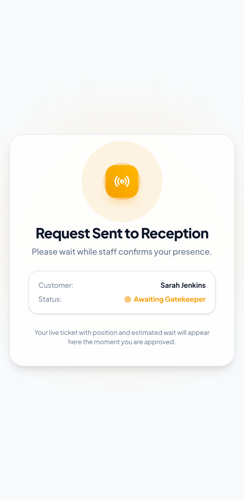
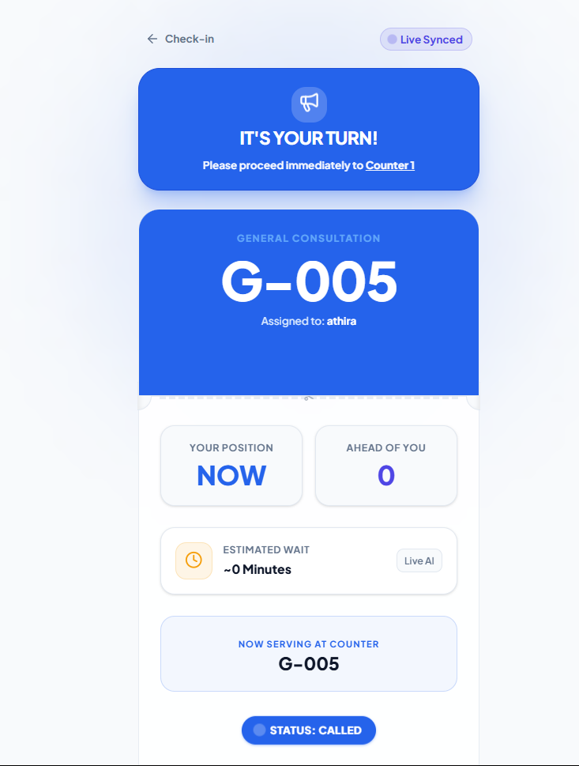
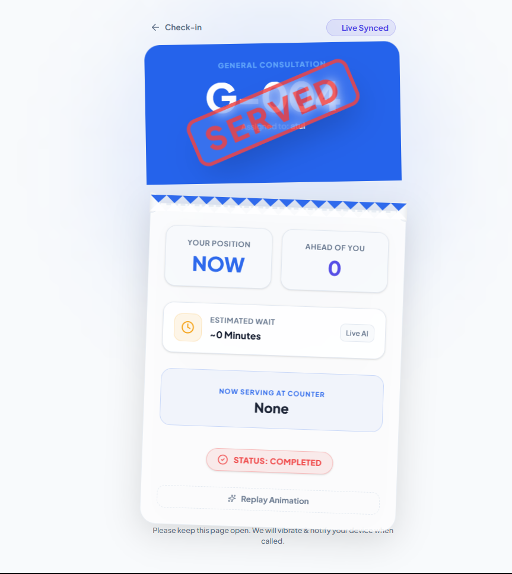
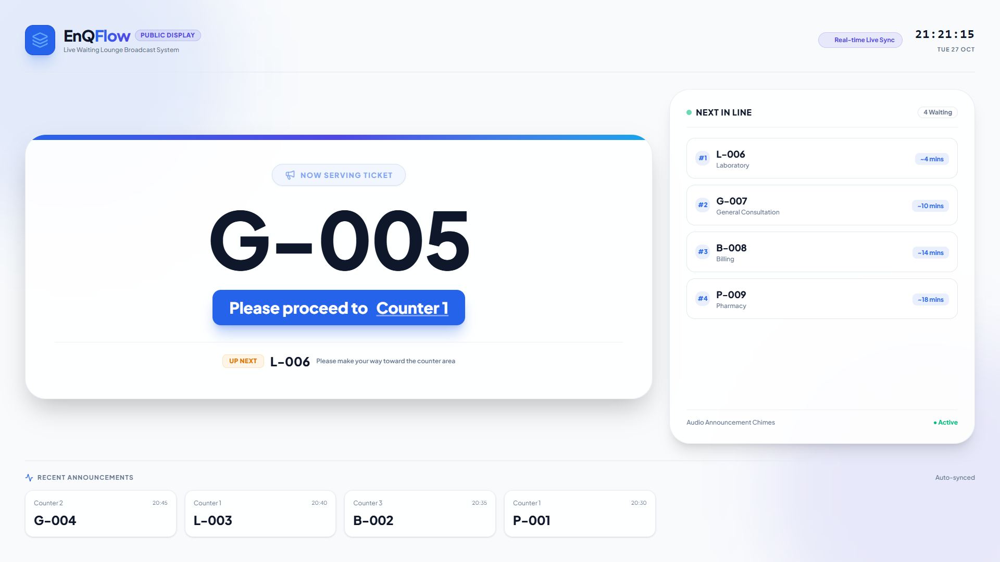

# EnQFlow

**EnQ** → Enqueue → Join | **Flow** → Move smoothly through the queue

A real-time digital queue management system designed for clinics, salons, and businesses. EnQFlow eliminates crowded waiting rooms and provides a seamless, app-free experience for customers while giving staff powerful management tools.

## The Hybrid Solution

Instead of forcing customers to download an app or allowing remote abuse of open digital queues, EnQFlow provides a smart hybrid approach:

1. **Physical QR Scan**: Customers scan a code at reception to request entry via a lightweight Web App (PWA).
2. **Staff Verification**: Receptionists verify the customer's presence and approve them via the Desktop App.
3. **Live Sync**: Both apps are perfectly synced in real-time, guiding the customer through their wait until they are called.

## Features
*   **Customer Web App (PWA)**: Mobile-first interface for joining queues, viewing live positions, and receiving browser push notifications.
*   **Digital Perforated Pass**: Animated digital ticket with realistic paper-tear physics when completed.
*   **Receptionist Desktop App**: Powerful Electron-based dashboard for approving requests, calling customers, and managing counters.
*   **Live Queue Registry & Hub**: Multi-tab dashboard showing real-time clinical metrics, incoming arrivals, and instant counter station management.
*   **Real-time Engine**: Powered by Socket.IO, ensuring sub-second updates across all connected clients.
*   **Public Display Mode**: A specialized TV/Monitor interface (`/display`) for showing currently called tickets.
*   **Safe SQLite Backups**: Built-in mechanisms to safely backup the database even while writes are occurring.

## Visual Tour

Here is a visual walkthrough of the EnQFlow system and its real-time views:

### 1. Live Reception Hub (Desktop App)

**What it does:** The primary cockpit for receptionists. Displays live metrics (incoming arrivals, currently waiting, counters in operation, completed count), a physical check-in QR code generator, real-time incoming arrival approvals, and an instant 1-click counter dispatch button.

### 2. Queue Registry (Desktop App)

**What it does:** A searchable, filterable real-time registry of all tickets issued today. Receptionists can filter by status (`WAITING`, `CALLED/SERVING`, `COMPLETED`, `CANCELLED`), call customers out of turn, or manage cancellations.

### 3. Counter Stations Dispatcher (Desktop App)

**What it does:** Allows multi-counter management. Receptionists can view the active status of each counter in the facility, switch active operating counters, and assign customer queues dynamically.

### 4. Reception Terminal Login (Desktop App)

**What it does:** Secure, token-authenticated staff login portal with organization validation and demo autofill credentials.

### 5. Customer Digital Experience (Mobile Web App / PWA)

<div align="center">
  <table>
    <tr>
      <td align="center" width="33%">
        <b>1. Mobile Contactless Check-In</b><br/><br/>
        
      </td>
      <td align="center" width="33%">
        <b>2. Verification Awaiting</b><br/><br/>
        
      </td>
      <td align="center" width="33%">
        <b>3. "Called" Turn State</b><br/><br/>
        
      </td>
    </tr>
  </table>
</div>

### 6. Digital Perforated Pass - "Completed" Tear Physics
<div align="center">
  
</div>

**What it does:** When service concludes, the digital ticket simulates a realistic physical paper tear with CSS animations, snapping off the perforated stub and stamping a red "SERVED" watermark.

### 7. Public Lounge TV / Display Broadcast Mode (`/display`)

**What it does:** A clean, high-contrast, fullscreen TV broadcast layout for waiting lounges. Syncs instantly via Socket.IO to announce newly called ticket numbers and directed counter stations.

## Architecture

The system consists of two client applications communicating with a central Node.js backend.

```text
                    EnQFlow
                       │
           ┌───────────┴───────────┐
           │                       │
           ▼                       ▼
   EnQFlow Desktop          EnQFlow Web/PWA
   Electron + React         React + Vite
   Receptionist             Customer
           │                       │
           └───────────┬───────────┘
                       │
                REST API + Socket.IO
                       │
                       ▼
                Node.js + Express
                       │
                       ▼
                    SQLite (better-sqlite3)
```

### Component Roles

*   **EnQFlow Web/PWA (Customer):** A lightweight React interface where customers join the queue and watch their live status. No app installation required; it uses Web Push for notifications and CSS animations to simulate a physical ticket.
*   **EnQFlow Desktop (Receptionist):** An Electron-based React dashboard for staff. It provides high-performance, real-time control over the queue, allowing staff to approve requests, assign counters, and monitor daily metrics.
*   **Node.js Backend (Server):** The central nervous system. It exposes REST APIs for standard data and uses Socket.IO for sub-second, bi-directional real-time events between the Web and Desktop clients, backed by a robust SQLite database.

## Queue State Machine

The backend enforces a strict state machine to prevent client-side manipulation.

1.  **REQUESTED**: Customer submits details via the web app.
2.  **APPROVED** / **DECLINED**: Receptionist physically verifies the customer. If approved, a Ticket is generated.
3.  **WAITING**: Customer is in the queue.
4.  **CALLED**: Customer's turn has arrived; they are assigned a counter.
5.  **SERVING**: Customer is actively being served.
6.  **COMPLETED**: Service finished.
7.  **NO_SHOW** / **CANCELLED**: Alternative termination states.

## Technology Stack

| Component | Technology |
| :--- | :--- |
| **Desktop App** | Electron, React, TypeScript, Vite, Tailwind CSS, Zustand |
| **Web App** | React, TypeScript, Vite, Tailwind CSS, PWA |
| **Backend** | Node.js, Express.js, TypeScript, Socket.IO |
| **Database** | SQLite (`better-sqlite3`) |
| **Validation & Auth** | Zod, bcrypt, JWT |

## Installation & Running the Application

### 1. Prerequisites
*   Node.js (v18+)
*   npm

### 2. Install Dependencies
Install dependencies for each project:

```bash
cd server && npm install
cd ../web && npm install
cd ../desktop && npm install
```

### 3. Environment Variables
Copy the `.env.example` file to `.env` in the `server` directory if custom configuration is needed.

### 4. Running the Applications

Open 3 terminal windows to run the components independently:

**Terminal 1 — Backend Server:**
```bash
cd server
npm run dev
```

**Terminal 2 — Customer Web App:**
```bash
cd web
npm run dev
```
Access at `http://localhost:5173` (or `/display` for public lounge TV).

**Terminal 3 — Receptionist Desktop App:**
```bash
cd desktop
npm run dev
```
Launches the Electron application window connected to the queue engine.

## Default Demo Credentials

*   **Email:** `receptionist@abchealth.com`
*   **Password:** `recept123`

## License

This project is licensed under the MIT License - see the [LICENSE](LICENSE) file for details.